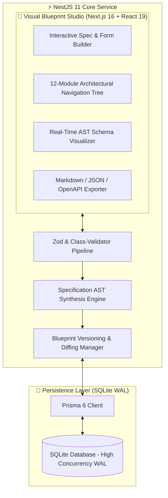
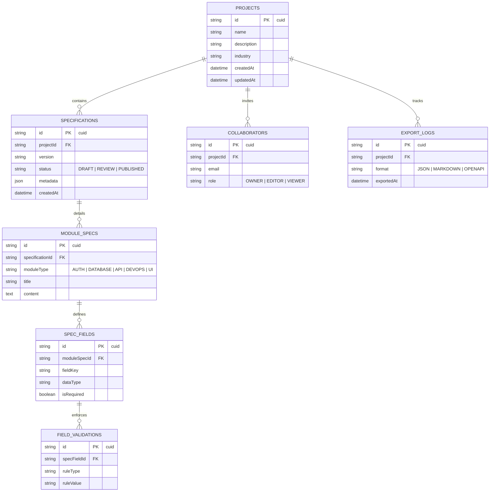
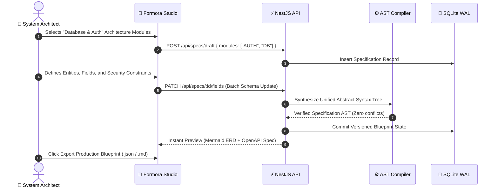

# 📋 Formora — Enterprise Specification Engine & Blueprint Studio

<div align="center">


**Interactive software blueprint studio and enterprise specification compiler converting product requirements into production architecture schemas.**

[System Architecture](#-system-architecture) • [Database ERD](#-database-erd-13-table-relational-schema) • [Synthesis Flow](#-specification-synthesis-workflow) • [Quick Start](#-quick-start)

</div>

---

## ⚡ Overview

**Formora** streamlines complex product planning. It allows engineering leaders to author, validate, and compile complex software specifications across 12 discrete architectural modules, maintaining sub-millisecond querying speed via an embedded **SQLite WAL** persistence layer.

---

## 🏗️ System Architecture



---

## 📊 Database ERD (13-Table Relational Schema)



---

## 🔄 Specification Synthesis Workflow



---

## 🚀 Quick Start

### 1. Install Dependencies
```bash
pnpm install
```

### 2. Run Database Migration
```bash
pnpm prisma db push
```

### 3. Start Development Server
```bash
pnpm run dev
```

Visit `http://localhost:3000` to launch Formora.

---

## 📄 License
MIT License © **[Ros Rendo](https://github.com/RosRendo)**
